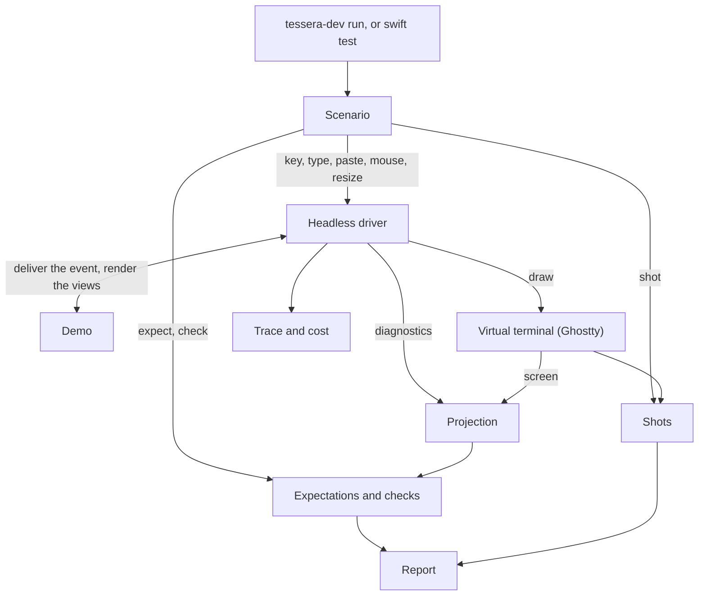

# Developer tooling

This page describes Tessera's developer tools: what each one is, how they fit together, and the rules they follow. They serve two audiences: contributors building Tessera, and authors of apps built on Tessera, who drive and check their own apps with the same harness, scenarios, and checks. Each tool's status in [The tools](#the-tools) says whether it exists yet or is only designed. The how-to for using them is the `tessera-devtools` skill (and, later, a user guide); this page is the design they implement.

## Why the tools exist

Without these tools, Tessera can render a view tree without a terminal and assert on cells, styles, the cursor, and the diagnostics tree. It cannot drive an app from a script, find an element by what it is rather than where it is, picture a screen for review, check structural invariants, explain why a frame redrew or why focus moved, or look inside a running app.

Those gaps are where two earlier, archived attempts at the view layer failed without anyone noticing: controls built before pointer input existed, a pressed state that never rendered, `ForEach` items stacked on one frame, test affordances leaking into public API, and docs written after the code ([Phase 4 tooling context](../research/phase-4-tooling-context-and-prior-attempts.md)). Those defects live in focus, pointer input, scrolling, controls, and collections. The tools exist so that every component comes with a demo that anyone, human or agent, can run, picture, query, and check, and so that the checks catch those defect classes mechanically.

The design draws on Textual's pilot and snapshot tests, oh-my-pi's debug socket and agent tool, Microsoft tui-test's locators, and Playwright's role-first addressing ([TUI devtools prior art](../research/tui-devtools-prior-art.md)). Five spikes under `spikes/` (HeadlessRunner, GraphQuery, SvgShot, LiveSocket, Seams) tried the riskiest parts against the real runtime; their READMEs record what each proved.

## Principles

1. **One grammar, two hosts.** A scenario is a plain text file. The same file runs in-process against a virtual terminal and, with live inspection, against a running app. A scenario is a test, a bug report, and a catalog fixture at once.
2. **The runtime returns facts; the harness judges them.** Expectations are evaluated against a projection of the diagnostics the runtime already produces. `TesseraCore` holds no assertion state and gains only value-typed diagnostics fields, each by spec amendment.
3. **Text first, pixels for review.** The Ghostty cell grid is the golden. SVG and PNG pictures help a human review a change; they are never committed and never compared.
4. **Time is injected.** No step sleeps. Waiting and animation are expressed against a clock the harness advances, and are not expressible until that clock exists rather than faked with real time.
5. **A plain agent contract.** One JSON object per command when stdout is not a terminal, fixed exit codes, and errors that name the accepted vocabulary. A selector that matches nothing is an error, not an empty result. Every output is shaped for the agent reading it: a field earns its place when it lets an agent find and fix a problem in fewer turns with less context, and a field that saves neither is left out.
6. **No test affordances in product API.** The view and terminal libraries expose no hooks for the harness: the seams it needs are `package`, never `public`, and the harness, which app authors import, uses them internally without re-exporting them. Text goldens are the only committed artefacts, and drift fails unless `--record` is passed.
7. **"Why" is answered by the trace, not by prints.** Demos find library bugs; the harness never works around them, and a demo is never bent to make a run pass.

## How the pieces fit



Read the diagram as one scenario run. `tessera-dev run` and `swift test` are two ways to start the same run. The scenario's input statements go to the headless driver, which delivers each one to the demo and draws the result into a Ghostty virtual terminal, the same way a live run draws into your terminal. After each step, the driver's diagnostics and the virtual terminal's screen together form the projection. The scenario's `expect` and `check` statements are answered from the projection, using locators to name the nodes they mean, and its `shot` statements save the screen as shots. Alongside, the driver writes the trace and cost of every step. Everything that passed or failed collects into one report, printed for a human or as JSON for an agent. Each box except the virtual terminal and the report has its own section under [The tools](#the-tools); the report is described under [`tessera-dev`](#tessera-dev).

## The tools

| Tool | Who uses it | Where it lives | Status |
| --- | --- | --- | --- |
| Demos and the registry | both | `Examples/Sources/DemoSupport` | designed |
| Headless driver (`Driver`, `HeadlessApp`) | both | `TesseraHarness` | designed |
| Scenario language and runner | both | grammar in `Examples/Scenarios/README.md`, runner in `TesseraHarness` | designed |
| `tessera-dev` CLI and `mise run dev:*` | agents first | `Examples/Sources/TesseraDev`, `mise-tasks/dev/` | designed |
| Projection and locators | agents first | `TesseraHarness` | designed |
| Invariant checks (`check`) | both | `TesseraHarness` | designed |
| Shots (text, grid, SVG) | both | goldens beside the scenario; pictures in `.build/tessera-dev/` | designed |
| Trace and cost | both | `TesseraHarness` | designed |
| Catalog conformance and the gallery | both | `tessera-dev conform`, `DevTools/gallery/` | designed |
| Keyboard coverage walk | agents | `tessera-dev coverage` | designed |
| Pointer verbs and hit query | both | scenario `mouse`, `hit` | designed |
| Schedulable clock | both | environment `Clock` plus scenario `wait`, `settle` | designed |
| Live inspection socket | agents | `TESSERA_DEBUG_SOCKET`, `tessera-dev attach` | designed |
| `tessera-devtools` skill | agents | `.agents/skills/tessera-devtools/` | designed |

### Demos

Each component ships with a small standalone demo. A demo shows its component working: it is interactive, it shows off every style and variant that can differ, and for a complex component it may include other controls that change the thing under demonstration, such as a picker that switches a table's style or a stepper that sets a progress value. A demo uses only what the library provides; when a demo exposes a library defect, the library gets a fix with a regression test, and the demo gets no workaround.

A demo has a registry name (kebab-case), a minimum size from its catalog doc, and the viewports it is tested at, which every demo declares explicitly (there is no default):

- `desktop`: 80x24.
- `mobile`: 40 columns at the demo's natural height. The harness measures natural height with a package-level nil-height proposal and proposes two heights to detect greed; a height-greedy demo fails `size mobile` with an error that names `mobileScreen`.
- `mobileScreen`: 40x16, for compositions meant to fill a screen.
- `custom`: any explicit size.

The registry is the one place demos are selected; it fails closed on a duplicate name. `tessera-dev demo run NAME` runs a demo live in your terminal; the same demo renders identically headless, so its renders are snapshot fixtures, and its snapshot test is a few lines. An intro app composes the per-component demos with navigation only; it adds no component behaviour.

### The headless driver

`TesseraHarness` is a library in the root package, beside `TesseraTestSupport`. It lives there because it needs `package` seams that a separate package cannot see (`InMemoryTerminalDevice.deliverResize`, `TerminalSession.lastDrawn`, the output tap). App authors import it to drive and check their own apps, so its public names are chosen for them; how it is distributed and what it promises about stability are still open (see [Open questions](#open-questions)).

The driver drives anything that adopts `HeadlessApp`: a reference type that owns its model, hands out `Binding`s to a root view (so controlled controls can write back), and applies the events the view graph leaves unhandled. `Demo` is `HeadlessApp` plus the registry name, minimum size, and viewports; an app that adopts `HeadlessApp` gets the same driver, scenarios, and checks as Tessera's own demos. An app that runs its own event loop directly over `TerminalSession`, as the current examples do, gives the driver nothing to call until it exposes its root view and event handling that way.

`Driver.step(event)` runs one canonical step per input: resize if asked, then `graph.dispatch`, then the app applies the event if the graph left it `.ignored`, then `graph.update()`, then `TerminalSession.draw` writes bytes into one persistent virtual terminal. The live runner is the same `Driver` over the real terminal device, so live and headless cannot drift; and because headless runs take the live drawing path, the session's colour, underline, and hyperlink policy and its differential rendering are exercised, not bypassed.

### Scenarios

A scenario is a text file under `Examples/Scenarios/`: one statement per line, shell quoting, `#` comments. A header binds the app and the terminal; the body sends input, observes, and asserts.

```text
# Tab moves focus from the name field to Submit.
app form-basics
size desktop
term colors=256 keyboard=kitty

key Tab
expect focused role=button label="Submit"
shot after-tab
check
```

| Group | Verbs |
| --- | --- |
| Header | `app NAME`, `size desktop\|mobile\|mobileScreen\|WxH`, `term colors=none\|16\|256\|true glyphs=ascii keyboard=legacy\|kitty theme=light\|dark\|probe` |
| Input | `resize WxH`, `key Tab`, `type "hi"`, `paste "..."`, `bytes "\x1b[A"`, `focus SEL`, `mouse click\|move\|scroll\|down\|up R,C`, `wait`, `settle` |
| Observe | `shot NAME [SEL]`, `tree [SEL]`, `dump [SEL]`, `hit R,C` |
| Assert | `expect text ROW "..."`, `expect screen <<EOF ... EOF`, `expect cell R,C bold fg=ROLE bg=ROLE`, `expect node SEL frame X,Y WxH \| visible \| clipped \| count N`, `expect focused SEL`, `expect cost bodies<=N measures<=N bytes<=N`, `expect wireframe PATH N [at SEL]`, `check [rule...]` |

The `term` header maps onto the session's real capability settings, so ASCII fallbacks, `NO_COLOR`, and backtab-versus-Shift+Tab are scenario facts rather than environment accidents. The harness answers the app's terminal colour queries itself from the header, with given colours or with none, so a styled golden never depends on the virtual terminal's default colours. Input is typed `InputEvent` verbs with `bytes` as the escape hatch; key names follow Playwright and are normalised (`Ctrl+C`). The parser binds the header first and fails fast with `FILE:LINE: error:`. A failed `expect` is recorded with the screen and the run continues, so one run reports every failure. `Examples/Scenarios/README.md` is the grammar's single source; a verb the library cannot honour yet (`wait` before the schedulable clock, `mouse` before hit testing) is listed there as not yet expressible, never faked.

### Locators

A selector (`SEL`) is a set of `key=value` pairs that addresses nodes by meaning and re-resolves on every statement:

- `type=Text` (short type name), `layout=…`, `id=…` (a `.id` or `ForEach` key, or a full identity path), `text="Submit"` (screen text attributed to the topmost leaf, so obscured text does not match), `nth=2`.
- `focused`, `focusable`.
- `role=button`, `label="Submit"`. Library controls set role and label through an internal hook; there is no public view API for it. A node without them falls back to a role derived from its type and a label from its screen text. The fields are plain values, so a later accessibility or Tern Surface Protocol export can read the same description.

Scenarios for controls use `role=` and `label=`, never coordinates.

### Projection

The projection is sorted-key JSON of the graph diagnostics (short `type` and `layout`, never reflected type names; counters and invalidation reasons; a pass marker; no durations) plus the screen (rows, style runs, and the cursor under its own key). Expectations, locators, checks, and `tree` all read it. A diff of two projections lists nodes added, removed, and changed by field, and the screen rows that changed.

### Checks

`check` runs named invariants over the projection and screen. Each rule is a pure function returning violations with a stable kebab-case id, the node, and a detail; `check` with no arguments runs them all.

| Rule | Catches |
| --- | --- |
| `no-dirty-after-pass` | a node still dirty after a completed pass |
| `frame-inside-clip` (warning) | content placed outside its clip |
| `measured-within-proposal` | a view claiming more than it was offered |
| `siblings-disjoint` | stack children on overlapping frames (the `ForEach` defect); `ZStack` and overlays are exempt |
| `requirements-aggregate` | terminal requirements that do not roll up to the root |
| `exactly-one-focus`, `focus-resolves` | zero or several focused nodes; focus on a node that no longer exists |
| `focused-visible`, `focus-indicated` | focus on a node that is clipped away; focus with no visible difference, including under `colors=none` |
| `tab-cycle-terminates`, `legend-keys-handled` | Tab cycles that never return; KeyLegend advertising a key nothing handles |
| `scroll-offset-within-content`, `selection-visible`, `unique-collection-ids` | scrolling past content; a selection scrolled out of view; duplicate collection IDs |

Single ownership of each `NodeState` row cannot be seen in the projection, so it stays a review rule backed by a lint.

### Shots and goldens

`shot NAME [SEL]` records the screen, or one node's frame region, as two text files beside the scenario: `NAME.txt` (the trimmed text) and `NAME.grid.txt` (the styled cell grid). They are the only committed artefacts. Drift from a committed golden fails the statement; `run --record` rewrites goldens and prints what changed. Never use `--record` to make a failing run pass.

Each shot also writes an SVG to `.build/tessera-dev/` (one text element per row, one span per style run, box-drawing and block glyphs drawn as geometry so they align without font metrics), plus a PNG on macOS. Under `term theme=probe`, every semantic role gets a unique colour that the projection maps back, so `expect cell 3,4 fg=focus` asserts in roles rather than RGB.

### Trace and cost

The driver writes one JSONL record per step: sequence number, event, the pass's invalidation reasons, the nodes and rows that changed, cost (bodies evaluated, measures, placements, rendered nodes, bytes written), `dispatch{disposition, handledBy, path}`, and `focus{from, to, cause}`. "Why did this redraw?", "which node swallowed this key?", and "why did focus move?" are all read from the trace. Cost is deterministic, so `expect cost` can assert it; wall-clock durations appear only under `run --timing` and are never golden. `run --repeat N` reruns a scenario and reports any divergence. A live session records its events to `TESSERA_TRACE=<file>` for `tessera-dev replay`.

### `tessera-dev`

`tessera-dev` is a thin CLI over the harness; it adds no behaviour the tests do not share.

| Command | Does |
| --- | --- |
| `demo list`, `demo run NAME` | list demos; run one live in this terminal |
| `run PATH...` | run scenario files or directories (`--record`, `--repeat N`, `--timing`, `--json`, `--pretty`) |
| `shot`, `tree`, `check` | one-off picture, tree, or check of a demo at a size |
| `replay FILE --app NAME` | rerun a recorded trace as a scenario |
| `coverage --app NAME` | walk the keyboard from initial focus with Tab and Shift+Tab, and the arrow keys inside lists and pickers: per focusable, its level (`shortcut` for a KeyLegend binding, `tab`, or `unreachable`) and its shortest route as a starting point plus key-and-count steps (`[["Tab", 2], ["Down", 3]]`, which replay directly as `key` statements), and why the walk stopped |
| `conform [DOC...]` | list every catalog wireframe fence and the scenario that pins it, or `unpinned` |
| `attach` | talk to a live app over the debug socket |

Exit codes: 0 pass, 1 an expectation or check failed, 2 a usage or parse error, 3 a harness error. When stdout is not a terminal, each command writes one JSON object to stdout; `help COMMAND` prints real text. `mise run dev:run`, `dev:shot`, and the rest mirror the commands. CI runs `swift test --package-path Examples` and `tessera-dev run Examples/Scenarios` on macOS, Linux, and Windows; goldens are checked out with LF line endings everywhere, so a Windows checkout cannot drift them.

### Catalog conformance and the gallery

The design catalog in `docs/design/` draws each component as wireframe fences (`wireframe WxH`, with an `id=` once pinned). `expect wireframe PATH N [at SEL]` compares the screen, or a node's region, cell for cell with the N-th fence, characters and roles both, and prints a per-cell diff on failure. `conform` reports pinned and unpinned fences as JSON, and CI fails when a catalog doc marked `implemented` has an unpinned fence, so a component's doc and its behaviour cannot drift apart.

The gallery (`DevTools/gallery/`, served by `scripts/gallery-serve.py`) shows each component three ways: the catalog wireframe, the current render from the working tree, and the previous render from the committed `.grid.txt`. A human reviews a regression as three pictures, and no image is committed.

### Live inspection

`TesseraCore` serializes nothing. A dev runner outside the library may, when `TESSERA_DEBUG_SOCKET=<path>` is set, open a local Unix-domain NDJSON endpoint (owner-only permissions, peer UID checked, one request per connection) that answers `text`, `grid`, `tree [SEL]`, `stats`, and `shot`, and injects `key`, `type`, `mouse`, `resize`, and `quit` through the normal step path. `tessera-dev attach` is its client. Every scenario runs both in-process and over the socket with identical reports, so the two transports cannot drift. The endpoint is off unless the variable is set, never listens on a network port, and is not available on Windows. Nothing else depends on it; without it, a live session is inspected through the trace and `lastDrawn` dumps, with input sent through the pty or tmux.

## The development loop

The loop the `tessera-devtools` skill teaches, for humans and agents alike:

1. `tessera-dev demo run NAME` to see the component.
2. `tessera-dev run Examples/Scenarios/NAME.scenario` and read the report (or its JSON).
3. `shot` to picture the failing state, `tree` to see the nodes and frames.
4. Read the trace to learn why a redraw or a focus move happened.
5. `check` to find the broken invariant.
6. Fix the library, never the demo, and rerun.

## Open questions

- How app authors consume the harness: whether they adopt `HeadlessApp` or drive the app runtime's scene, and which names carry a stability promise. (libghostty-vt reaches apps as a prebuilt binary; see [libghostty-vt distribution](libghostty-vt-distribution.md).)
- How an app gets `tessera-dev`: its own small executable over the harness, or a shared tool.

## Keeping this page current

This page is the index for the tools. A change that adds or changes a tool updates the matching section here, and the `tessera-devtools` skill, in the same change: what the tool is now, what it does not do yet, and its status in [The tools](#the-tools). When a tool grows past a section, its detail moves to its own page under `docs/architecture/developer-tooling/`, and this page keeps a summary and a link. How-tos belong in the skill and the user guide, not here.

## Affected plans

- [Build the Phase 4 view layer with the tooling that proves it](../plans/phase-4-view-layer-and-developer-tooling.md), which builds these tools.
- [Developer tooling for agents and humans](../plans/developer-tooling.md) (cancelled), where the design, spikes, and decisions were made.
