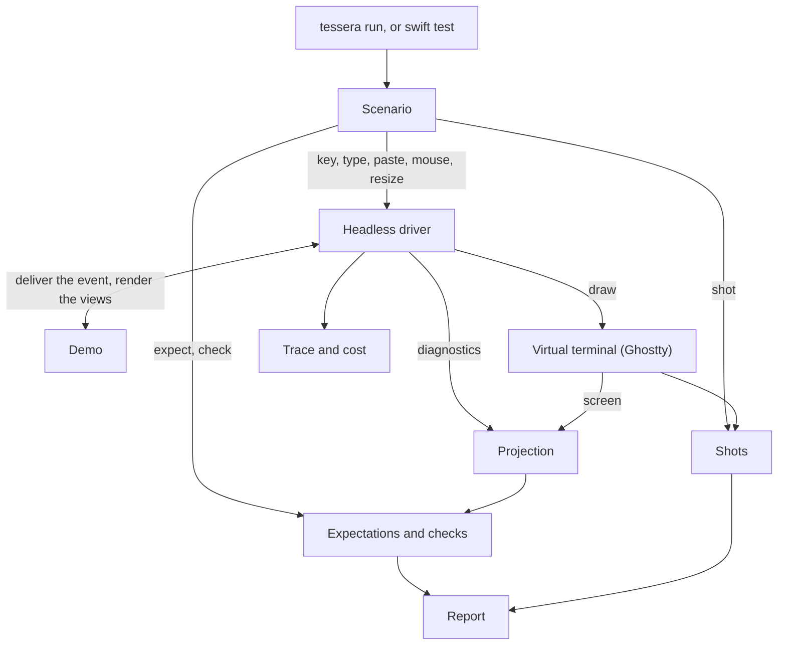

# Developer tooling

This page describes Tessera's developer tools: what each one is, how they fit together, and the rules they follow. They serve two audiences: contributors building Tessera, and authors of apps built on Tessera, who drive and check their own apps with the same harness, scenarios, and checks. Each tool's status in [The tools](#the-tools) says whether it exists yet or is only designed. The how-to for using them is the `tessera` skill for app authors and `tessera-contributing` for contributors (and, later, a user guide); this page is the design they implement.

## Why the tools exist

Without these tools, Tessera can render a view tree without a terminal and assert on cells, styles, the cursor, and the diagnostics tree. It cannot drive an app from a script, find an element by what it is rather than where it is, picture a screen for review, check structural invariants, explain why a frame redrew or why focus moved, or look inside a running app.

Those gaps are where two earlier, archived attempts at the view layer failed without anyone noticing: controls built before pointer input existed, a pressed state that never rendered, `ForEach` items stacked on one frame, test affordances leaking into public API, and docs written after the code ([Phase 4 tooling context](../research/phase-4-tooling-context-and-prior-attempts.md)). Those defects live in focus, pointer input, scrolling, controls, and collections. The tools exist so that every component comes with a demo that anyone, human or agent, can run, picture, query, and check, and so that the checks catch those defect classes mechanically.

The design draws on Textual's pilot and snapshot tests, oh-my-pi's debug socket and agent tool, Microsoft tui-test's locators, and Playwright's role-first addressing ([TUI devtools prior art](../research/tui-devtools-prior-art.md)). Five spikes under `spikes/` (HeadlessRunner, GraphQuery, SvgShot, LiveSocket, Seams) tried the riskiest parts against the real runtime; their READMEs record what each proved.

## Principles

1. **One grammar, two hosts.** A scenario is a plain text file. The same file runs in-process against a virtual terminal and, with live inspection, against a running app. A scenario is a test, a bug report, and a catalog fixture at once.
2. **The runtime returns facts; the harness judges them.** Expectations are evaluated against a projection of the diagnostics the runtime already produces. `TesseraCore` holds no assertion state and gains only value-typed diagnostics fields, each by spec amendment.
3. **Text first, pixels for review.** The Ghostty cell grid is the golden. SVG and PNG pictures help a human review a change; they are never committed and never compared.
4. **Time is injected.** No step sleeps. Waiting and animation are expressed against a clock the harness advances, and are not expressible until that clock exists rather than faked with real time.
5. **A plain agent contract.** One JSON object per command when stdout is not a terminal, fixed exit codes, and errors that name the accepted vocabulary. A selector that matches nothing is an error, not an empty result. Every output is shaped for the agent reading it: a field earns its place when it lets an agent find and fix a problem in fewer turns with less context, and a field that saves neither is left out.
6. **No test affordances in product API.** The view and terminal libraries expose no hooks for the harness: the seams it needs are `package`, never `public`, and the harness, which app authors import, uses them internally without re-exporting them. Text goldens are the only committed artefacts, and drift fails unless `--record` is passed.
7. **"Why" is answered by the trace, not by prints.** Demos find library bugs; the harness never works around them, and a demo is never bent to make a run pass.

## How the pieces fit



Read the diagram as one scenario run. `tessera run` and `swift test` are two ways to start the same run. The scenario's input statements go to the headless driver, which delivers each one to the demo and draws the result into a Ghostty virtual terminal, the same way a live run draws into your terminal. After each step, the driver's diagnostics and the virtual terminal's screen together form the projection. The scenario's `expect` and `check` statements are answered from the projection, using locators to name the nodes they mean, and its `shot` statements save the screen as shots. Alongside, the driver writes the trace and cost of every step. Everything that passed or failed collects into one report, printed for a human or as JSON for an agent. Each box except the virtual terminal and the report has its own section under [The tools](#the-tools); the report is described under [`tessera`](#tessera).

## The tools

| Tool | Who uses it | Where it lives | Status |
| --- | --- | --- | --- |
| Demos and the registry | both | demos in `Examples/Sources/DemoSupport`, `ApplicationRegistry` in `TesseraHarness` | built; one demo so far, the counter |
| The app contract (`Application`) | both | `TesseraRuntime`, re-exported by `Tessera` | built |
| Headless driver (`Driver`) | both | `TesseraHarness` | built: one `Driver` under a headless host, a live host, and a per-test actor host, all internal to `TesseraHarness` (tests reach them with `@testable import`) |
| Scenario language and runner | both | grammar in `Examples/Scenarios/README.md`, parser, runner, and report in `TesseraHarness` | built for the statements the harness can honour today; the rest are refused by name until their prerequisite exists |
| `tessera` CLI and `mise run dev:*` | agents first | `Examples/Sources/TesseraDev`, `HarnessCLI` in `TesseraHarness`, `mise-tasks/dev/` | `apps`, `launch`, `run`, `shot`, `tree`, and `help` built; `check` and `replay` are named and refuse until the projection and the trace exist |
| Projection and locators | agents first | `TesseraHarness` | designed |
| Invariant checks (`check`) | both | `TesseraHarness` | designed |
| Shots (text, grid, SVG) | both | goldens beside the scenario; pictures in `.build/tessera/` | text shots and goldens built (`NAME.txt`); the styled grid and the pictures designed |
| Trace and cost | both | `TesseraHarness` | designed |
| Catalog conformance and the gallery | both | `tessera conform`, `DevTools/gallery/` | designed |
| Keyboard coverage walk | agents | `tessera coverage` | designed |
| Pointer verbs and hit query | both | scenario `mouse`, `hit` | designed |
| Schedulable clock | both | environment `Clock` plus scenario `wait`, `settle` | designed |
| Live inspection socket | agents | `TESSERA_DEBUG_SOCKET`, `tessera attach` | designed |
| `tessera` skill | agents of app authors | `.agents/skills/tessera/` | built; covers each tool built above |
| `tessera-contributing` skill | agents of contributors | `.agents/skills/tessera-contributing/` | built; covers the `mise` tasks and the demos, over the `tessera` skill |
| File-level quality checks | contributors | steps in `hk.pkl`, run by the pre-commit hook, `hk check`, and `mise run quality:lint` | built |

### Demos

Each component ships with a small standalone demo. A demo shows its component working: it is interactive, it shows off every style and variant that can differ, and for a complex component it may include other controls that change the thing under demonstration, such as a picker that switches a table's style or a stepper that sets a progress value. A demo uses only what the library provides; when a demo exposes a library defect, the library gets a fix with a regression test, and the demo gets no workaround.

A demo has a registry name (kebab-case), a minimum size from its catalog doc, and the viewports it is tested at, which every demo declares explicitly (there is no default):

- `desktop`: 80x24.
- `mobile`: 40 columns at the demo's natural height. The harness measures natural height with a package-level nil-height proposal and proposes two heights to detect greed; a height-greedy demo fails `size mobile` with an error that names `mobileScreen`.
- `mobileScreen`: 40x16, for compositions meant to fill a screen.
- `custom`: any explicit size.

The registry (`ApplicationRegistry`) is the one place apps, Tessera's demos among them, are selected; it fails closed on a duplicate name, and its factories are main-actor closures. `tessera launch NAME` runs an app live in your terminal; the same demo renders identically headless, so its renders are snapshot fixtures, and its snapshot test is a few lines. An intro app composes the per-component demos with navigation only; it adds no component behaviour. "Demo" is Tessera's word for its own per-component example apps; the CLI and the scenario header say `app`.

Built today: `Demo` in `Examples/Sources/DemoSupport` is an `Application` that also declares its registry name, minimum size, viewports, and fixtures (further registrations of the same demo), none of them defaulted, and `Demos.registry()` registers every demo and fixture into one `ApplicationRegistry`. A demo quits on `q`, matched by `isQuitKey`, which compares the key's code, modifiers, and kind and never `Key` equality, so an enriched Kitty key still quits and a release or a repeat does not. The first demo is the counter. Registering a name twice is not an error where it is written; it makes every read of the registry fail (exit 3 from a command, a failing report from a scenario), so a later registration never replaces an earlier one. A demo's snapshot test is a few lines in `Examples/Tests/DemoSupportTests`: it opens the demo headless at a viewport, sends keys, and asserts rows of the screen.

### The headless driver

`TesseraHarness` is a library in the root package, beside `TesseraTestSupport`. It lives there because it needs `package` seams that a separate package cannot see (`InMemoryTerminalDevice.deliverResize`, `TerminalSession.lastDrawn`, the output tap). App authors import it from their test and dev targets to drive and check their own apps, so its public names are chosen for them and are the ones [Stability](#stability) promises; libghostty-vt reaches apps as a prebuilt binary (see [libghostty-vt distribution](libghostty-vt-distribution.md)).

The harness drives anything that adopts `Application`, declared in `TesseraRuntime` and re-exported by `Tessera`: a reference type that owns its model, whose `body` is the root view (it reads the model and hands out `Binding`s so controlled controls can write back), whose `apply(_:)` receives each event the view graph left `.ignored` and every resize, and whose `isFinished` tells the host to stop. Every requirement uses only `Tessera` types, so an app written against `Tessera` alone conforms where the type is declared, or with `extension MyApp: Application {}` in a test or dev target when production code must stay free of the contract. The contract carries no isolation: the harness steps apps on the main actor, so an app whose model is main-actor isolated declares a main-actor isolated conformance (`: @MainActor Application`), and a nonisolated app runs on any host; a mismatch is a compile error, not a runtime trap. `ApplicationRegistry` names each app and holds a main-actor factory that the harness opens once per run, so each run starts fresh and a fixture is one more registration. `Demo` is `Application` plus the registry name, minimum size, and viewports; an app that adopts `Application` gets the same driver, scenarios, and checks as Tessera's own demos. The harness has no quit key: quitting is the app's `isFinished`. An app that runs its own event loop directly over `TerminalSession` keeps it in production, and that loop must match the canonical step below until the app adopts the Phase 5 runtime, which hosts the same protocol.

`Driver` is a `@MainActor` shell over one nonisolated step that takes the host's isolation as an `isolated any Actor` parameter; the Phase 5 runtime is a second shell over the same step. `Driver.step(event)` runs the canonical step per input: resize the graph if the event is a resize, then `graph.dispatch`, then the app applies the event if the graph left it `.ignored` (a resize always reaches the app, because it is never routed), then `graph.update()`; then `TerminalSession.draw` runs its body in the driver's isolation and commits the frame into one persistent virtual terminal. The live runner is the same `Driver` over the real terminal device, so live and headless cannot drift; and because headless runs take the live drawing path, the session's colour, underline, and hyperlink policy and its differential rendering are exercised, not bypassed. The step is synchronous: when it returns, `apply` has run, the graph is updated, and the screen is rendered, so a scenario statement is one step and nothing sleeps. The full contract is the spec's [Runtime isolation](../spec/phase-5-runtime-and-polish.md#runtime-isolation) section.

Built today: the driver delivers its starting size to the app as a `.resize` through the same step, before the first frame, because an app has no other way to learn the size it starts at. The headless host runs a session over a device of the harness's own (`HeadlessTerminalDevice`) and feeds every frame from the session's output tap to one persistent Ghostty virtual terminal; the harness does not use `InMemoryTerminalDevice` because that device lives in a module that links the snapshot-testing library, and an executable that links it cannot launch. The live host opens the real terminal and hands the session's scope a main-actor function value, so the app's conformance never leaves the main actor. Tessera's nonisolated demos can also be stepped on a per-test actor, which keeps parallel suites parallel. `mobile` is 40 columns at the height the app's content needs, which the harness measures with a package-level nil-height proposal on `ViewGraph` and confirms by measuring at two tall heights: an app whose root grows with the proposal has no natural height, and `size mobile` fails naming `mobileScreen`. Isolation is pinned by two compile-fail fixtures, each with a positive control, that `mise run quality:architecture` runs: an actor host given a main-actor app, and a default-main-actor type adopted from another module without `@MainActor` on the conformance.

### Scenarios

A scenario is a text file under `Examples/Scenarios/`: one statement per line, shell quoting, `#` comments. A header binds the app and the terminal; the body sends input, observes, and asserts.

```text
# The counter steps on `+` and `-`, resets on `0`, and ignores everything else.
app counter
size mobile
term colors=256 theme=dark

type "++"
bytes "+\x1b[A"
expect text 2 "Count                                  3"
shot after-steps
```

| Group | Built | Designed, refused until its prerequisite exists |
| --- | --- | --- |
| Header | `app`, `size`, `term colors= theme=light\|dark` | `term glyphs=`, `term keyboard=`, `term theme=probe` |
| Input | `resize`, `key`, `type`, `paste`, `bytes` | `focus SEL`, `mouse`, `wait`, `settle` |
| Observe | `shot NAME`, `tree` | `shot NAME SEL`, `tree SEL`, `dump`, `hit R,C` |
| Assert | `expect text`, `expect screen`, `expect node SEL frame` | `expect node SEL visible\|clipped\|count N`, `expect focused SEL`, `expect cell`, `expect cost`, `expect wireframe`, `check` |

`Examples/Scenarios/README.md` is the grammar's single source: the exact syntax of every statement, the quoting rules, the key names, the report, and the "not yet expressible" table; this page says what each part is for and what is built. A form the library cannot honour yet (`wait` before the schedulable clock, `mouse` before hit testing, `check` before the projection) is a parse error that says what it waits for, never a statement that is skipped or a check that passes without checking.

Input is typed `InputEvent` verbs with `bytes` as the escape hatch, which runs its text through the same input parser a live session uses; key names follow Playwright and are normalised (`Ctrl+C`). The parser binds the header first and fails fast with `FILE:LINE: error:`, reads lines at `\n` and treats a `\r` as whitespace so a CRLF checkout parses like an LF one, and treats an unknown statement as an error so a scenario written for a newer harness fails loudly on an older one. A failed `expect` is recorded with the screen and the run continues, so one run reports every failure.

A scenario ends when its app finishes, as a live run does: the statement that finishes the app (`key q` for the counter) is the last that runs, and the next statement fails with its own verb and a message naming the line that finished the app, so a scenario cannot pass by running on against an app a terminal would have closed.

The `term` header names the terminal the app runs on, not the machine running the scenario. `colors` is the colour level the session renders with, which the session applies as its forced colour capability. The harness answers the session's terminal queries itself, from fixed values: with `theme=light` or `theme=dark` it reports that scheme's foreground, background, and 16 palette colours to OSC 10, 11, and 4 queries, and without a theme it reports none, as a terminal that cannot answer would; it always answers the primary device attributes query, so a probe round ends at once instead of at its timeout. A styled golden therefore never depends on the Ghostty virtual terminal's default colours. Built today, the answering is pinned at the headless device by tests, but the headless session still detects capabilities passively and so sends no colour query yet; the host switches to active detection with the terminal half of [terminal color reports](../spec/phase-3/slice-06-terminal-capability-detection.md#terminal-color-reports), when styling first reads the colours. `glyphs=` and `keyboard=` wait for ASCII glyph fallbacks in the views and for key routing that depends on the keyboard protocol, so they are refused today rather than accepted and ignored.

### Locators

A selector (`SEL`) is a set of `key=value` pairs that addresses nodes by meaning and re-resolves on every statement:

- `type=Text` (short type name), `layout=…`, `id=…` (a `.id` or `ForEach` key, or a full identity path), `text="Submit"` (screen text attributed to the topmost leaf, so obscured text does not match), `nth=2`.
- `focused`, `focusable`.
- `role=button`, `label="Submit"`. Library controls set role and label through an internal hook; there is no public view API for it. A node without them falls back to a role derived from its type and a label from its screen text. The fields are plain values, so a later accessibility or Tern Surface Protocol export can read the same description.

Scenarios for controls use `role=` and `label=`, never coordinates.

### Projection

The projection is sorted-key JSON of the graph diagnostics (short `type` and `layout`, never reflected type names; counters and invalidation reasons; a pass marker; no durations) plus the screen (rows, style runs, and the cursor under its own key). Expectations, locators, checks, and `tree` all read it. A diff of two projections lists nodes added, removed, and changed by field, and the screen rows that changed.

### Checks

`check` runs named invariants over the projection and screen. Each rule is a pure function returning violations with a stable kebab-case id, the node, and a detail; `check` with no arguments runs them all.

| Rule | Catches |
| --- | --- |
| `no-dirty-after-pass` | a node still dirty after a completed pass |
| `frame-inside-clip` (warning) | content placed outside its clip |
| `measured-within-proposal` | a view claiming more than it was offered |
| `siblings-disjoint` | stack children on overlapping frames (the `ForEach` defect); `ZStack` and overlays are exempt |
| `requirements-aggregate` | terminal requirements that do not roll up to the root |
| `exactly-one-focus`, `focus-resolves` | zero or several focused nodes; focus on a node that no longer exists |
| `focused-visible`, `focus-indicated` | focus on a node that is clipped away; focus with no visible difference, including under `colors=none` |
| `tab-cycle-terminates`, `legend-keys-handled` | Tab cycles that never return; KeyLegend advertising a key nothing handles |
| `scroll-offset-within-content`, `selection-visible`, `unique-collection-ids` | scrolling past content; a selection scrolled out of view; duplicate collection IDs |

Single ownership of each `NodeState` row cannot be seen in the projection, so it stays a review rule backed by a lint.

### Shots and goldens

`shot NAME [SEL]` records the screen, or one node's frame region, as two text files beside the scenario: `NAME.txt` (the trimmed text) and `NAME.grid.txt` (the styled cell grid). They are the only committed artefacts. Drift from a committed golden fails the statement; `run --record` rewrites goldens and prints what changed. Never use `--record` to make a failing run pass.

Built today: `shot NAME` compares the trimmed screen text, every row without its trailing spaces and trailing empty rows dropped, with `NAME.txt` in a directory named like the scenario file without its extension, beside it (`counter-basics.scn` keeps its goldens in `counter-basics/`), so shot names only need to be unique within a scenario. A missing golden or a drifted one fails the `shot` statement with the first differing row and the screen, and `tessera run --record` writes the files and lists what changed; a golden checked out with CRLF fails with a message that says so, and `.gitattributes` keeps this repository's goldens LF. The styled grid (`NAME.grid.txt`), the SVG, and the PNG are designed and not built, so the `shot` statement takes no selector yet.

Shot names are unique within a scenario ignoring case, since goldens are files and the macOS and Windows file systems fold case: `shot a` and `shot A` is a parse error. A golden that holds a carriage return fails as a CRLF golden before any row is compared, and a missing or CRLF golden reports no expected or actual row, because there is nothing to compare.

Each shot also writes an SVG to `.build/tessera/` (one text element per row, one span per style run, box-drawing and block glyphs drawn as geometry so they align without font metrics), plus a PNG on macOS. Under `term theme=probe`, every semantic role gets a unique colour that the projection maps back, so `expect cell 3,4 fg=focus` asserts in roles rather than RGB.

### Trace and cost

The driver writes one JSONL record per step: sequence number, event, the pass's invalidation reasons, the nodes and rows that changed, cost (bodies evaluated, measures, placements, rendered nodes, bytes written), `dispatch{disposition, handledBy, path}`, and `focus{from, to, cause}`. "Why did this redraw?", "which node swallowed this key?", and "why did focus move?" are all read from the trace. Cost is deterministic, so `expect cost` can assert it; wall-clock durations appear only under `run --timing` and are never golden. `run --repeat N` reruns a scenario and reports any divergence. A live session records its events to `TESSERA_TRACE=<file>` for `tessera replay`.

### `tessera`

`tessera` is a thin CLI over the harness; it adds no behaviour the tests do not share. Tessera's own executable registers Tessera's demos, and an app author's executable is `HarnessCLI.main(registry:)` over the app's own registry.

| Command | Does |
| --- | --- |
| `apps`, `launch NAME` | list registered apps; run one live in this terminal |
| `run PATH...` | run scenario files or directories (`--record`, `--repeat N`, `--timing`, `--json`, `--pretty`) |
| `shot`, `tree`, `check` | one-off picture, tree, or check of a demo at a size |
| `replay FILE --app NAME` | rerun a recorded trace as a scenario |
| `coverage --app NAME` | walk the keyboard from initial focus with Tab and Shift+Tab, and the arrow keys inside lists and pickers: per focusable, its level (`shortcut` for a KeyLegend binding, `tab`, or `unreachable`) and its shortest route as a starting point plus key-and-count steps (`[["Tab", 2], ["Down", 3]]`, which replay directly as `key` statements), and why the walk stopped |
| `conform [DOC...]` | list every catalog wireframe fence and the scenario that pins it, or `unpinned` |
| `attach` | talk to a live app over the debug socket |

Exit codes: 0 pass, 1 an expectation or check failed, 2 a usage or parse error, 3 a harness error. When stdout is not a terminal, each command writes one JSON object to stdout; `help COMMAND` prints real text. `mise run dev:run`, `dev:shot`, and the rest mirror the commands. CI runs `swift test --package-path Examples` and `tessera run Examples/Scenarios` on every leg of the test matrix, macOS, Linux, and Windows among them, and all are required checks; goldens are checked out with LF line endings everywhere, so a Windows checkout cannot drift them.

Built today: `apps`, `launch NAME`, `run PATH...`, `shot NAME [SIZE]`, `tree NAME [SIZE]`, and `help [COMMAND]`, with `--json` and `--pretty` forcing either form of any of them. `apps` prints a name, minimum, and viewports table on a terminal, and otherwise one sorted-key JSON object, `{"apps": [{"minimum", "name", "viewports"}], "command": "apps"}`, where `minimum` is `null` for an app that declares none. `launch` refuses to start unless standard input and output are both terminals (exit 3, before the terminal changes mode), because it opens a live session; an unknown name is a usage error (exit 2) that lists the registered names. `run` takes `.scn` files and directories (every `.scn` under a directory, sorted, hidden entries skipped), runs each scenario against a fresh app, and prints one report per scenario: the human form on a terminal, and otherwise `{"command": "run", "exitCode", "scenarios": [REPORT...]}`, where a report is `{"failures", "observations", "passed", "scenario"}` with `recorded` when `--record` wrote goldens and `seconds` under `--timing`. A failure is `{"line", "statement", "verb", "message"}` with `expected`, `actual`, and `screen` when the statement compares values, and its `verb` decides the exit code: a statement's own verb, `size`, or `repeat` is an expectation that failed (1), `parse` and `usage` are mistakes in the file or the command (2), and `harness` is a fault in the run (3); the highest of a run wins. A scenario that does not parse is not run and reports one `parse` failure. `--record` writes goldens, `--repeat N` runs each scenario N times and reports a `repeat` failure for any run whose report differs from the first, and `--timing` adds the seconds of each run, which are the only numbers that differ between two runs. `shot` prints the screen of one app at a size (`desktop`, `mobile`, `mobileScreen`, or `WxH`) as a golden would hold it, and `tree` prints its node tree, one line per node; both take the app as a positional name, answer a size the app cannot take with a usage error, and have JSON forms `{"app", "command", "exitCode", "rows" or "lines", "size"}`. `check` and `replay` are designed and are not commands: a command the harness does not have is a usage error (exit 2) that lists the commands, so nothing passes without checking. `HarnessCLI.main(registry:)` is the entry point an app author's executable calls; `Examples/Sources/TesseraDev` is Tessera's, over `Demos.registry()`, and its product is named `tessera` while its module is `TesseraDev`, so the executable and the `Tessera` library share no artifact name on a case-insensitive file system. `ScenarioRunner(registry:record:)` is the Swift entry point to `run`, one report per scenario, so an app's tests and its command line run the same scenarios the same way.

The commands and flags are declared with [swift-argument-parser](https://github.com/apple/swift-argument-parser), and only `TesseraHarness` depends on it (`scripts/check-package-boundaries.py` allowlists the one product), so the library, the runtime, and the terminal targets stay free of it. ArgumentParser parses the arguments and writes the help; `HarnessCLI` keeps the promises it would not: a usage error exits 2 where ArgumentParser exits 64, and the JSON or text form is read from the raw `--json` and `--pretty` before parsing, so a parse that fails is still reported in the form the caller asked for. A usage error says what is accepted where it happened: the commands for an unknown command, the app names for an unknown app, and the command's usage for a bad flag or argument. The executable prints a completion script for fish, zsh, and bash with `--generate-completion-script SHELL`, and `launch`, `shot`, and `tree` complete the registered names by asking the executable at completion time, so no list can fall out of date. `HarnessCLI.main(registry:)` stays the only entry point, and no command depends on how the executable was found, so a prebuilt front end or a SwiftPM plugin can forward to an app's executable unchanged.

Each `dev:*` task that takes an app name takes it as an optional argument. Run without one, it prints the command's help and the registered apps, where mise would report a missing argument; `dev:run` without a path prints `run`'s help. At a terminal that is the answer and the task exits 0; in a pipe or a script nothing ran, so the task exits 2, as `tessera` does, and an unset variable cannot pass for success. A `dev:*` task builds `tessera` once, quietly, and runs the binary it built, so a build that succeeds prints nothing and one that fails still prints its errors. `mise run dev:launch <Tab>` completes the app names, and `dev:shot` and `dev:tree` the sizes after them, from the `Examples/.build/debug/tessera` an earlier run built; completion never builds, so it offers nothing until there is one.

### Stability

Tessera 1.0 promises a small surface to app authors and their CI, and leaves everything else free to change. The public Swift names are `Application` (in `TesseraRuntime`, re-exported by `Tessera`) and, in `TesseraHarness`, `ApplicationRegistry`, `Viewport`, `HarnessCLI` (`main(registry:)`), `ScenarioRunner`, `ScenarioReport`, and `ScenarioFailure`. Everything else in the harness is `package` or internal, and there is no public stepping API: app authors drive an app through scenarios, run from `swift test` by `ScenarioRunner` or from their dev executable by `HarnessCLI`. Within a major version these stay as they are:

- **The scenario grammar.** Every statement, header key, `term` option, locator key, role name, and check rule id documented in `Examples/Scenarios/README.md` keeps its syntax and meaning. Additions are additive, and an unknown statement stays a parse error (exit 2), so a scenario that uses a newer statement fails loudly on an older harness. `type=` values are public view type names; framework-private names are not covered.
- **The exit codes**: 0 pass, 1 an expectation or check failed, 2 a usage or parse error, 3 a harness error.
- **The JSON report's fields.** Fields are added, never removed, renamed, or retyped, and consumers ignore fields they do not know.
- **The CLI's commands and flags**: `apps`, `launch`, `run`, `shot`, `tree`, `check`, and `help`, with `--record`, `--repeat N`, `--timing`, `--json`, and `--pretty`. A prebuilt front end or a SwiftPM plugin only forwards to this command line, which keeps the question of how an app gets `tessera` open.
- **The golden file formats.** `NAME.txt` and `NAME.grid.txt` keep their format, so a harness upgrade alone never drifts an app's goldens. A library rendering change (a widget drawing differently) is a library change and drifts goldens like any other; the release notes say so.
- **The check rule ids.** A rule added in a minor version runs when named and joins bare `check` only at the next major, so a minor release cannot fail an app's CI with a rule the app never asked for.

Free to change in any release, each carrying a version field where it has a schema: the tree and projection JSON that `tree` and `dump` print; the trace and `replay`; the numbers `expect cost` compares (its syntax is covered, the counts are the library's work, so assert them with `<=` bounds); SVG and PNG shots; `coverage` output; `conform`, which reads Tessera's own catalog; and the live-inspection socket protocol and `attach`.

### Catalog conformance and the gallery

The design catalog in `docs/design/` draws each component as wireframe fences (`wireframe WxH`, with an `id=` once pinned). `expect wireframe PATH N [at SEL]` compares the screen, or a node's region, cell for cell with the N-th fence, characters and roles both, and prints a per-cell diff on failure. `conform` reports pinned and unpinned fences as JSON, and CI fails when a catalog doc marked `implemented` has an unpinned fence, so a component's doc and its behaviour cannot drift apart.

The gallery (`DevTools/gallery/`, served by `scripts/gallery-serve.py`) shows each component three ways: the catalog wireframe, the current render from the working tree, and the previous render from the committed `.grid.txt`. A human reviews a regression as three pictures, and no image is committed.

### Live inspection

`TesseraCore` serializes nothing. A dev runner outside the library may, when `TESSERA_DEBUG_SOCKET=<path>` is set, open a local Unix-domain NDJSON endpoint (owner-only permissions, peer UID checked, one request per connection) that answers `text`, `grid`, `tree [SEL]`, `stats`, and `shot`, and injects `key`, `type`, `mouse`, `resize`, and `quit` through the normal step path. `tessera attach` is its client. Every scenario runs both in-process and over the socket with identical reports, so the two transports cannot drift. The endpoint is off unless the variable is set, never listens on a network port, and is not available on Windows. Nothing else depends on it; without it, a live session is inspected through the trace and `lastDrawn` dumps, with input sent through the pty or tmux.

### File-level quality checks

Each file-level check is one step in `hk.pkl`, declared once with the files it applies to: `swiftlint` and `swift-format` on the Swift sources, tests, and Examples package, `prettier` on YAML, JSON, and the few script and stylesheet files, `rumdl` on Markdown, `codespell` on every text file, and `docc` on DocC catalogs (macOS only, one `mise run docs:lint` for however many files changed). Nothing else declares them. The pre-commit hook runs the steps on the staged files, `hk check` on the changed files (`hk check --staged` on the staged ones), and `hk check --all` on every file, which is what `mise run quality:lint` and CI run beside the repository-wide checks (wireframes, architecture, plans hub, release notes, vouch, TOML); `mise run quality:format` is `hk fix --all`.

The hook runs in the checkout, not in a copy of the index. hk stashes unstaged changes before the pre-commit steps (`stash = "git"`), so each step sees only the staged content in place, and `mise run setup:hooks` points the hook at `mise x -- hk run pre-commit`, so every tool resolves from the checkout's trusted `mise.toml` whichever shell made the commit. An earlier script checked the index out into a temporary directory instead, and a commit from a shell where mise was not activated failed there, because mise has never trusted the copy's `mise.toml`. The same setup wraps the hook in `git-ita-lift` where it is installed, because Git cannot stash while a file is intent-to-add.

## The development loop

The loop the `tessera` skill teaches app authors, for humans and agents alike:

1. `tessera launch NAME` to see the app.
2. `tessera run PATH` on the app's scenario, and read the report (or its JSON).
3. `shot` to picture the failing state, `tree` to see the nodes and frames.
4. Read the trace to learn why a redraw or a focus move happened.
5. `check` to find the broken invariant.
6. Fix the app and rerun; when the fault is Tessera's, report a Tessera bug and do not work around it.

The `tessera-contributing` skill runs the same loop over Tessera's own demos: through `mise run dev:*`, on a scenario from `Examples/Scenarios`, and with step 6 as fix the library, add a regression test, and never bend the demo.

## Open questions

- How an app gets `tessera`: its own small executable over the harness (`HarnessCLI.main(registry:)`), a prebuilt front end that forwards to it, or a SwiftPM command plugin.

## Keeping this page current

This page is the index for the tools. A change that adds or changes a tool updates the matching section here and the skills, in the same change: the `tessera` skill first, as an app author sees the tool, then `tessera-contributing` for what only a contributor has. The page says what the tool is now, what it does not do yet, and its status in [The tools](#the-tools); the skills describe only what exists. When a tool grows past a section, its detail moves to its own page under `docs/architecture/developer-tooling/`, and this page keeps a summary and a link. How-tos belong in the skill and the user guide, not here.

## Affected plans

- [Build the Phase 4 view layer with the tooling that proves it](../plans/phase-4-view-layer-and-developer-tooling.md), which builds these tools.
- [Developer tooling for agents and humans](../plans/developer-tooling.md) (cancelled), where the design, spikes, and decisions were made.
- [Run the file-level quality checks as hk steps](../plans/hk-quality-steps.md), which moved the file-level checks into `hk.pkl`.
